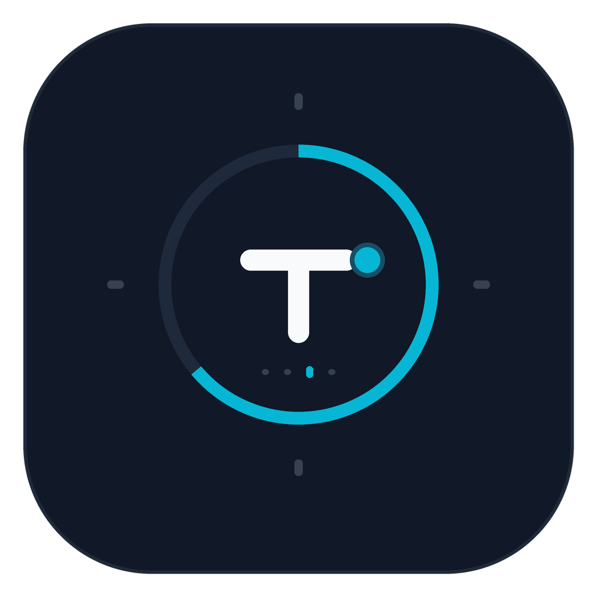

# ⏱️ Timey: Native Android Focus & Study Timer

<p align="center">
  
</p>

> **The Complete Pomodoro, 135:15 Deep Work & Focus Engine for Android**  
> Built with Kotlin 2.0, Jetpack Compose, Material 3, Room Database, DataStore, and Android 14+ Foreground Services. 100% offline, zero tracking, and zero background freeze.

[](https://github.com/contactaurawealth-lab/Timey/releases/tag/v1.0.0)
[-3DDC84?style=flat-square&logo=android&logoColor=white)](https://developer.android.com)
[](https://kotlinlang.org)
[](https://developer.android.com/jetpack/compose)
[](https://developer.android.com/training/data-storage/room)
[](LICENSE)

---

## ✨ Features

### 1. 🔬 Science-Backed Focus Engines
- **Classic Pomodoro (25/5)**: 25 minutes of disciplined focus followed by 5-minute recovery intervals and an automated deep recovery break every 4 cycles.
- **135:15 Deep Work Cycle**: Engineered for deep technical work, mathematical problem solving, and intensive study blocks (135m focus + 15m break).
- **Ultradian Sprint (50/10)**: 50-minute cognitive sprints matching natural human alertness rhythms.
- **Flowmodoro**: Unconstrained count-up flow with automated 1:5 recovery break calculation.
- **Exam Hall Simulator**: Continuous countdown with strict distraction penalties and disabled pauses.
- **Phase Skipping & Accidental Termination Safeguard**: Skip to the next phase with a single tap, or safeguard active sessions with confirmation dialogs and security PIN locks.

### 2. 🛡️ Focus Shield & Android App Blocker
- **Accessibility Service Intercept**: Monitors foreground window transitions to instantly intercept distracting apps (Instagram, TikTok, YouTube, Reddit, Discord, etc.).
- **Blocker Overlay**: Inspiring fullscreen takeover displaying current study topic, remaining countdown, and return button.
- **PIN Password Protection**: Optional 4-digit PIN lock required to end sessions early or bypass blocked apps.
- **Permission Health Audit**: In-app onboarding with direct system settings intent shortcuts for Accessibility, Exact Alarms, and Battery Optimization.

### 3. 🧘 Immersive Fullscreen Focus Mode
- Fullscreen distraction-free view utilizing `WindowInsetsControllerCompat` to hide system status and navigation bars.
- Minimalist circular timer ring, rotating motivational study quotes, and hold/PIN protected exit.

### 4. 🎧 Ambient Soundscapes & MP3 Music Player
- **7 Procedural Offline Soundscapes**: Algorithmic 16-bit PCM synthesis without external audio files (*Gentle Rain & Thunder, Forest Birds, Binaural Alpha Waves 10Hz, Deep Brown Noise, Crisp White Noise, Campfire, Lo-Fi Chill Pulse*).
- **Personal MP3 Playlist**: Import personal MP3/WAV/OGG tracks via Android file picker with looping (Repeat One / Repeat All) and shuffle controls.
- **Custom Completion Ringtones**: Choose between procedural acoustic chimes (*Zen Temple Bell, Gentle Arpeggio, Focus Pulse, Serene Morning*), system default tones, and user-imported custom ringtones.
- **Separate Volume Controls**: Independent sliders for background study music and timer completion alerts.

### 5. 📊 Room-Backed Analytics & Insights
- **Persistent Storage**: Room database logging every focus session (start/end timestamp, duration, subject, mode, completed status, XP).
- **Study Streaks**: Calendar-accurate streak tracking calculating current streak and personal best.
- **Weekly Canvas Bar Chart**: Custom 7-day visualization highlighting daily study minutes.
- **Subject-Wise Breakdown**: Progress distribution tracking time invested per subject (Math, CS, Physics, Literature, etc.).
- **Session History**: Detailed audit trail of past study sessions.

### 6. 🎨 Mobile-First Native UI/UX
- Distraction-free Material 3 design with light and dark modes.
- 5 customizable accent palettes (*Emerald Focus, Warm Amber, Sky Horizon, Sunset Coral, Sage Forest*).
- 5-destination bottom navigation bar: **Timer**, **Music**, **Blocker**, **Analytics**, and **Settings**.
- Responsive layout adapting between single-column portrait and 2-column landscape/tablets.

---

## 🏛 Architecture & Tech Stack

```
com.timey.app/
├── core/
│   ├── alarm/          # ExactAlarmScheduler, AlarmBroadcastReceiver, RingtoneHelper, Synthesizer
│   ├── audio/          # AudioTrackGenerator, SoundscapePlayer, MusicPlaylistManager
│   ├── blocker/        # FocusAccessibilityBlockerService, BlockerOverlayActivity, PermissionHelper
│   ├── notification/   # BootReceiver & high-priority Notification Channels
│   ├── service/        # FocusForegroundService (specialUse | mediaPlayback), QuickTileService
│   └── ui/             # CircularTimerRing, KomodoRoadCard, Theme & Color palettes
├── data/
│   ├── local/          # Room TimeyDatabase, StudySessionDao, StudySessionEntity, Repository
│   └── preferences/    # DataStore Preferences (TimeyPreferencesRepository)
├── domain/
│   └── model/          # TimerMode, PomodoroPhase, ThemeMode, AlarmSound, CompanionState
├── features/
│   ├── analytics/ui/   # AnalyticsScreen with Canvas Weekly Bar Chart & Subject Breakdown
│   ├── blocker/ui/     # BlockerScreen with app search & permission status
│   ├── fullscreen/ui/  # FullscreenFocusScreen with immersive distraction-free view
│   ├── music/ui/       # MusicScreen with soundscapes, personal playlist & volume sliders
│   ├── settings/ui/    # SettingsScreen for custom intervals, ringtones & accent colors
│   └── timer/          # TimerMainScreen, SubjectSelectionDialog, TimerViewModel
└── MainActivity.kt     # ComponentActivity with MainAppScaffold navigation
```

---

## 🛠 Building from Source

```bash
git clone https://github.com/contactaurawealth-lab/Timey.git
cd Timey

# Run Unit Tests
./gradlew test

# Assemble Debug APK (outputs to app/build/outputs/apk/debug/app-debug.apk)
./gradlew assembleDebug

# Assemble Release APK (outputs to app/build/outputs/apk/release/app-release.apk)
./gradlew assembleRelease
```

---

## 📄 License
Timey is open-source software licensed under the [MIT License](LICENSE).
